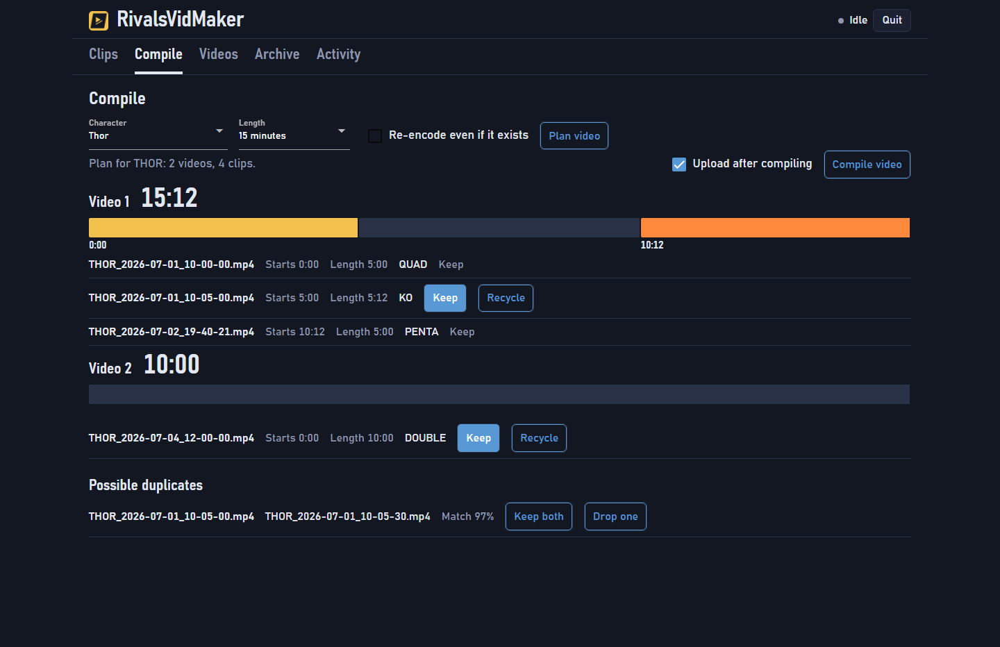

# Rivals Vid Maker

Every multi-kill, found and timestamped for you. Save your best Marvel Rivals plays in game, and RivalsVidMaker turns the pile of short clips into ready-to-upload 15-minute YouTube videos: it finds every Quad, Penta and Hexa, joins the clips in seconds, writes the description with a clickable timestamp for each big kill, and uploads it to your channel. No editor, no scrubbing through footage.

## Why you will want it

- **Every big kill, found for you.** It reads the kill banner in each clip, so every Quad, Penta and Hexa is spotted without you watching anything back.
- **Timestamps your viewers can click.** Each video comes with a description that jumps straight to every Quad+ moment.
- **A 15-minute video in seconds.** Clips are joined without re-encoding, so a full video is ready in about ten seconds, not ten minutes.
- **Straight to YouTube.** Sign in once and it uploads to your channel, remembers what went up, and lets you retry a failed upload later.
- **No wasted clips.** It warns about near-duplicate clips before building, keeps your Quad+ clips in an archive for a future best-of, and clears the rest to the recycle bin when you are done.
- **Runs on your PC.** Nothing leaves your machine except the upload you approve.

## See it

## How it works

Double-click `scripts/gui.bat` and the RivalsVidMaker window opens in your browser.

1. **Play and save.** Press save on a highlight in Marvel Rivals; clips land in your Highlights folder.
2. **Clips tab:** sort new clips into one folder per character and scan them for multi-kills.
3. **Compile tab:** pick a character and press Plan video to see exactly which clips make each 15-minute video and where the big kills land. Press Compile video to build it, and upload it in the same step if you like.
4. **Videos tab:** open it on YouTube, mark it live, then clean up: Quad+ clips go to the archive, the rest to the recycle bin.

Prefer a terminal? `scripts/run.bat` opens an arrow-key menu with the same workflow.

## Get started

One-time setup takes about ten minutes (Python, Tesseract and your folder paths): see [docs/SETUP.md](docs/SETUP.md).

## Licence

[MIT](LICENSE)
